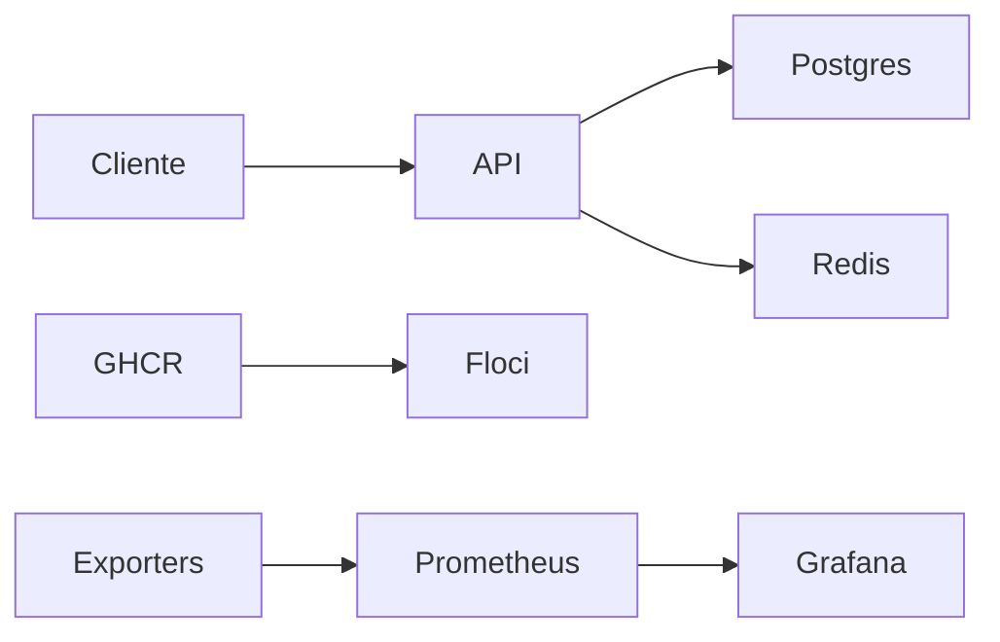

# CCU4-FinalProject-4

**Documento editable · BORRADOR PARA REVISIÓN DEL EQUIPO**

Proyecto: CCU4-FINAL · PaaS híbrido autoescalable · Grupo 4
Autor de este documento: Johana, Site Reliability Engineer y Documentación
Fecha: 2026-11-27
Entrega prevista: `CCU4-FinalProject-4.pdf` (miércoles 2 de diciembre, 11 PM)

**Estado del borrador:** incluye resultados reales verificables hasta el commit `55044eb` en `main`, ahora con stack local, monitoreo, Locust y chaos ejecutados. No incluye resultados de AWS ni capturas de Floci porque no se ejecutaron o no estaban disponibles. No se inventaron capturas, despliegues ni métricas.

## 1. Introducción

Este reporte documenta el estado del proyecto final de Cloud Computing del CETYS, una mini-PaaS para un sistema de pedidos de cafetería. La plataforma corre en local con Floci y, cuando aumenta el tráfico, debe crecer hacia AWS bajo control de políticas de costo y seguridad, para luego liberar recursos automáticamente.

## 2. Objetivo del proyecto

Construir una plataforma híbrida autoescalable con una API stateless, frontend, Postgres, Redis, pipeline de CI/CD, despliegue en Floci, auto-scaler en AWS, monitoreo, pruebas de carga y resiliencia verificable. La aplicación de ejemplo permite ver el menú, crear pedidos y consultarlos.

## 3. Arquitectura actual

El stack local (`docker-compose.yml`) está formado por `web` (Nginx en `localhost:3000`), `api` (FastAPI en `localhost:8000`), `postgres` con volumen `pgdata` y `redis`. La API usa Postgres para pedidos y Redis como caché del menú.

El pipeline de GitHub Actions construye y publica imágenes en GHCR; Floci registra tareas ECS locales a partir de `infra/floci/*-task.json`. El monitoreo se levanta con un Compose complementario en `infra/monitoring/`: Prometheus, dos exportadores propios y Grafana.

Diagrama Mermaid completo: `docs/arquitectura.md`. Su contenido no se reproduce aquí para evitar duplicación.



## 4. Tecnologías utilizadas

Python 3.13, FastAPI, Uvicorn, psycopg 3, Redis-py, PostgreSQL 16, Redis 7, Nginx, Docker y Docker Compose, Floci, GitHub Actions, GHCR, AWS IAM y AWS Budgets, Prometheus y Grafana, Locust, boto3 (responsabilidad de Emilio) y reportlab para generar este PDF.

## 5. Responsabilidades del equipo

| Integrante | Responsabilidades oficiales | Estado en el repositorio al 2026-11-27 |
|---|---|---|
| Emilio | Floci, scripts AWS con boto3 y auto-scaler | Tareas de Floci presentes; controller y scripts AWS pendientes |
| Jesús | GitHub Actions, GHCR, rolling update y reverse proxy | Pipeline en verde e imágenes publicadas; proxy pendiente |
| Carlos | Frontend, API, Postgres, Redis, Dockerfiles y Lambda | API, web y compose presentes; Lambda pendiente |
| Johana | Monitoreo, Locust, chaos, IAM, Budget, reportes y PDF | IAM y Budget como código; Prometheus/Grafana/Locust/chaos implementados y verificados en local; documentación en curso |

## 6. Hitos y resultados verificables

### Milestone 1

- Pipeline `CI` con cuatro checks en verde: run `45953227796`, 2026-11-27T06:39:14Z a 06:40:34Z.
- Imágenes `api` y `web` publicadas en GHCR con tags `latest` y `sha-55044eb`, según logs del pipeline.
- Política IAM y Budget definidos, validados en modo local; sin aplicación real a AWS.
- Reporte del Milestone 1 y diagrama de arquitectura en `docs/`.
- Detalle: `docs/reporte-milestone-1.md`.

### Milestone 2

- Scripts boto3 y Lambda: pendientes de Emilio y Carlos.
- IAM y Budget listos para cuando esos scripts se integren; el controller debe enviar `InstanceType` explícito.

### Milestone 3

- Prometheus con 3 jobs estáticos, 2 jobs `file_sd_configs`, 8 reglas de alerta y retención de 15 días.
- Grafana con datasource y dashboard aprovisionados, 12 paneles y 3 variables.
- `promtool check config`: SUCCESS. `promtool check rules`: SUCCESS, 8 reglas.
- Controller y proxy: pendientes; sus archivos `targets.d/` están vacíos a propósito.

### Milestone 4

- Locust con siete fases: normal, incremento gradual, pico, sostenida, disminución, recuperación y fin.
- Ejecución real: 14,076 peticiones, 0 fallos, promedio 22.6 ms, p95 agregado de 84 ms y 52 req/s, de 21:07:07Z a 21:11:38Z.
- Chaos controlado con ocho criterios verificables, recuperación automática y sin borrado de volúmenes.
- Ejecución real: ocho escenarios en `ok`, `reverse_proxy` en `pendiente`, pedido 4231 íntegro y código de salida 0.

## 7. Seguridad IAM y AWS Budget

La política `infra/aws/iam-policy-micro-only.json` bloquea `RunInstances` con tipos distintos de `t2.micro` y `t3.micro`, bloquea la omisión del tipo, prohíbe redimensionar a tipos no autorizados y limita EC2 a `us-east-1`. Los permisos concedidos son los necesarios para que el auto-scaler describa, cree, etiquete y termine instancias.

El presupuesto `infra/aws/budget.json` es de 1.00 USD mensual con alertas ACTUAL al 50/80/100 % y FORECASTED al 100 %. El correo se inyecta por `AWS_BUDGET_EMAIL`. AWS Budget solo notifica: no detiene costos. No se asume que las instancias micro sean gratuitas.

No se crearon recursos reales, no se adjuntó la política a ningún principal y no se generaron cargos.

## 8. Monitoreo

Se instrumentó sin modificar la API de Carlos: `app-exporter` sondea `/health` y `/menu` y expone disponibilidad, latencia, RPS de sondas y errores HTTP; `docker-exporter` consulta Docker Engine para CPU, memoria y estado de contenedores. Prometheus persiste 15 días en un volumen; las alertas están visibles en `/alerts` y aún no tienen Alertmanager.

Para medir RPS, latencia y errores del tráfico real de clientes se necesita autorización para agregar `/metrics` a la API. Hasta entonces, los paneles están nombrados como sondas.

## 9. Grafana

Datasource `Prometheus` con UID `prometheus-ccu4`, impulsado por archivos versionados y carpeta `CCU4`. El dashboard `ccu4-overview.json` incluye disponibilidad, tráfico de sondas, latencia promedio y p95, errores, CPU, memoria, contenedores activos, targets y un panel de texto con los contratos pendientes. Incluye filtros por endpoint, contenedor y job, y rango temporal de una hora por defecto.

## 10. Pruebas de carga

Locust usa el contrato real de `docs/api.md`: `GET /menu`, `POST /orders`, `GET /orders/{id}` y `GET /health`. El destino por defecto es local y se bloquea cualquier otro salvo autorización explícita. La ejecución real generó 14,076 peticiones sin fallos; el desglose fue 5,772 `GET /menu`, 4,224 `POST /orders`, 2,716 `GET /orders/{id}` y 1,361 `GET /health` en el snapshot final del CSV. El registro de fases con timestamps permitirá correlacionar el escalamiento con los logs de AWS cuando el controller exista, sin superar los 5 a 10 minutos de vida de instancias que indica el README.

## 11. Chaos engineering

El script `chaos/run_chaos.ps1` detiene y reinicia `api`, detiene temporalmente `web`, verifica la persistencia de un pedido real y deja el stack recuperado. No elimina volúmenes ni recursos ajenos. Incluye un modo con PID de Locust para observar recuperación bajo carga. En la ejecución real el pedido 4231 permaneció íntegro y solo quedó pendiente el escenario del reverse proxy, porque Jesús aún no lo despliega. La pérdida de un nodo AWS no se simula sin autorización.

## 12. Matriz de pruebas y resultados reales

| Prueba | Resultado |
|---|---|
| Validación IAM/Budget (`verify.py`) | Ejecutada: OK |
| Simulación `setup_iam.py` y `setup_budget.py` | Ejecutada: sin llamadas a AWS |
| Validación JSON/YAML | Ejecutada: 10 archivos válidos |
| Validación Compose principal y de monitoreo | Ejecutada: código 0 |
| `promtool check config` y `check rules` | Ejecutada: SUCCESS, 8 reglas |
| Compilación Python | Ejecutada: código 0 |
| Pipeline y GHCR | Verificado por API y logs de GitHub Actions |
| Stack local, Prometheus en vivo y Grafana | Ejecutada: 3 targets `up`, 9 contenedores y dashboard con datos |
| Locust real | Ejecutada: 14,076 peticiones, 0 fallos, p95 84 ms |
| Chaos real | Ejecutada: 8 escenarios `ok`, proxy `pendiente` |
| AWS real y correlación con Locust | Pendientes: requieren autorización y controller |

Matriz completa: `docs/matriz-pruebas.md`.

## 13. Incidencias y post-mortem

Incidencias principales: daemon de Docker apagado al inicio (resuelto), falta de scope `read:packages` para listar GHCR, ausencia de controller y proxy, falta de `/metrics` en la API y ausencia de dashboard de Floci en este equipo. Durante la integración se corrigieron tres defectos propios: el exporter de Docker no soportaba socket Unix en Python 3.13, el script de chaos comprobaba la raíz de la API en lugar de `/health`, y PowerShell 5.1 necesitaba BOM para codificar el informe. `promtool` no estaba instalado y se resolvió descargando el release oficial a un directorio temporal; las rutas del config se ajustaron para que la validación local no emitiera advertencias.

Detalle: `docs/incidencias.md` y `docs/post-mortem.md`.

## 14. Evidencias disponibles y pendientes

Disponibles: pipeline CI, push a GHCR por logs, herramientas y validación local IAM/Budget, validación de Prometheus con `promtool`, evidencia de stack real, targets y dashboard, CSV/HTML de Locust y JSON de chaos.

Pendientes: captura visual de Floci, captura de GHCR Packages, AWS real, correlación Locust ↔ AWS y validación del reverse proxy de Jesús.

Índice: `docs/evidencia/README.md`. Toda evidencia incluye fecha y hora.

## 15. Conclusiones y trabajo pendiente

La parte de Johana quedó implementada como código reproducible, integrada sin sobrescribir el trabajo de sus compañeros y verificada en vivo: stack local, Prometheus, Grafana, Locust y chaos funcionaron con datos reales. Para completar el PDF definitivo se necesita: capturas de Floci y GHCR, el reverse proxy de Jesús y los logs de creación y terminación de instancias del controller de Emilio. Hasta entonces este documento es un borrador honesto, sin datos ficticios.

## 16. Comandos de referencia

```bash
python infra/aws/verify.py
docker compose up -d --build
docker compose -f infra/monitoring/docker-compose.monitoring.yml --env-file infra/monitoring/.env.example config --quiet
promtool check config infra/monitoring/prometheus/prometheus.yml
promtool check rules infra/monitoring/prometheus/rules/cafeteria-alerts.yml
powershell -ExecutionPolicy Bypass -File ./loadtest/run_loadtest.ps1
powershell -ExecutionPolicy Bypass -File ./chaos/run_chaos.ps1
```
