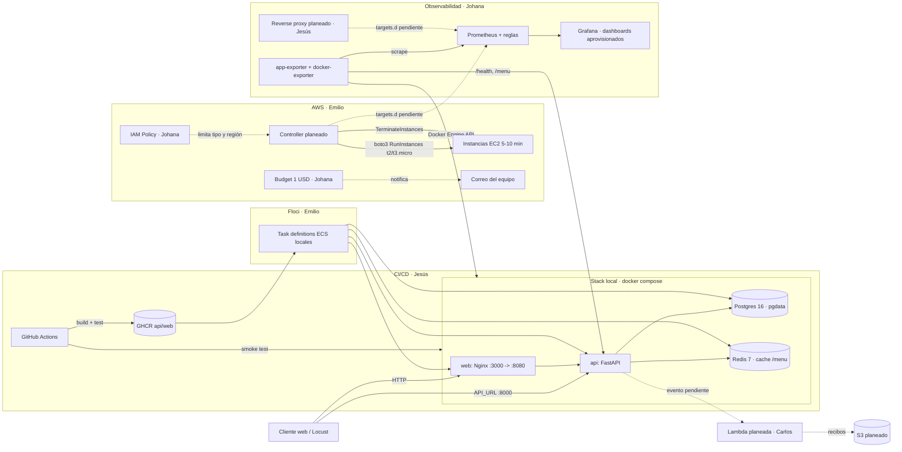

# Diagrama de arquitectura (borrador)

Borrador del Milestone 1, actualizado con los componentes de monitoreo implementados por Johana. Los bloques marcados como `planeado` dependen de código que aún no existe en el repositorio (controller, proxy y Lambda).

## Contratos pendientes para completar el diagrama

| Componente | Integrante | Contrato que necesita Johana |
|---|---|---|
| Controller | Emilio | Dirección y puerto de `/metrics`, o alta de un archivo en `prometheus/targets.d/controller.json` con `{"targets":["host:9090"]}` |
| Reverse proxy | Jesús | Endpoint de métricas o registro en `targets.d/reverse-proxy.json` |
| Lambda | Carlos | Definición del evento `order created` y formato del recibo |

Las líneas punteadas representan integraciones pendientes, no flujos verificados.
