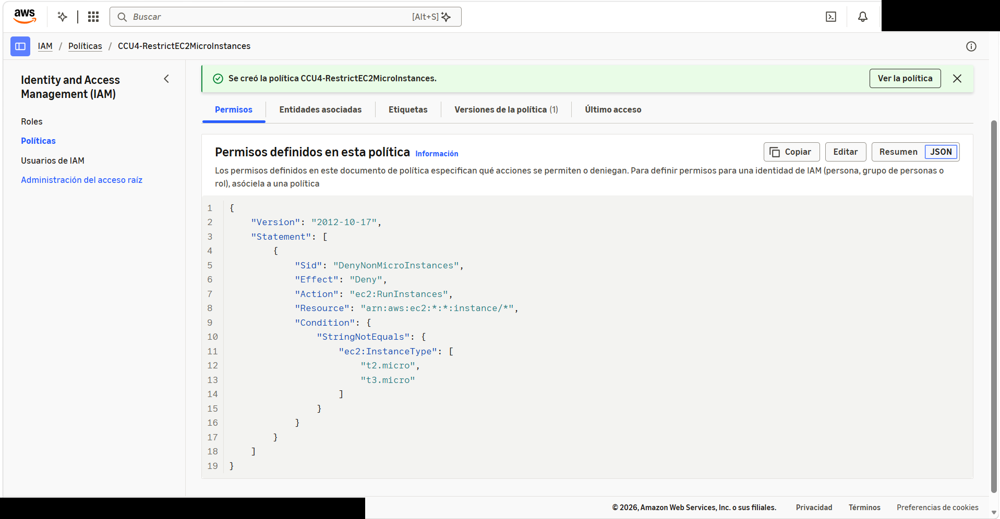
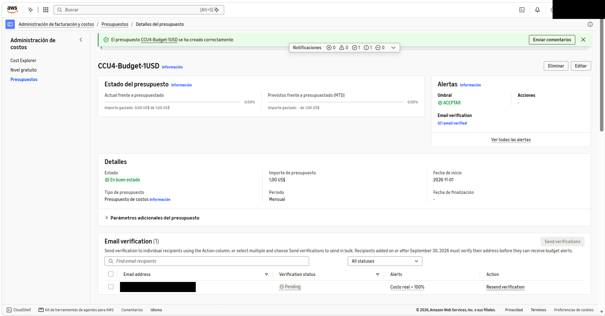

# Evidencia real · IAM y AWS Budget en cuenta gratuita

- Fechas de entrega de los archivos: 2026-11-27 14:40 y 14:47 -08:00, según metadatos de los PNG. La consola AWS no muestra una marca de tiempo dentro de la captura, por lo que esas horas corresponden al archivo entregado, no a un cronómetro de AWS.
- Responsable: Johana (SRE).
- Fuente: capturas de la consola AWS en la cuenta gratuita, aportadas por el usuario.
- Archivos públicos: [`AWS_IAM_Policy.png`](AWS_IAM_Policy.png) y [`AWS_Budget_Alarm.png`](AWS_Budget_Alarm.png).

## 1. Recursos creados, configuraciones aplicadas y pruebas realizadas

| Elemento | Estado demostrado por la captura | Lo que la captura NO demuestra |
|---|---|---|
| Política IAM `CCU4-RestrictEC2MicroInstances` | **Recurso creado** en IAM y con el documento JSON visible | No demuestra que esté adjuntada a un usuario/rol, ni que se haya probado un `RunInstances` denegado |
| Presupuesto `CCU4-Budget-1USD` | **Recurso creado** con límite mensual de 1.00 USD, periodo `Mensual` y regla de alerta visible | No demuestra entrega real del correo ni creación/terminación de instancias |
| Validaciones locales de `infra/aws/` | **Prueba ejecutada** con `verify.py` y simulaciones sin llamadas a AWS; detalle en `2026-11-27-1244-herramientas.md` | No equivale a `verify.py --live` ni a una prueba de autorización en AWS |
| Revisión de las capturas | **Prueba ejecutada**: OCR, detección de datos sensibles y ocultamiento en las copias públicas | No sustituye una auditoría de la cuenta AWS |

## 2. Política IAM `CCU4-RestrictEC2MicroInstances`

La captura muestra el mensaje de creación de la política y la pestaña **Resumen JSON**. La regla visible es una guardarraíl de denegación:

- `"Effect": "Deny"`.
- `"Action": "ec2:RunInstances"`.
- `"Resource": "arn:aws:ec2:*:*:instance/*"`.
- `"Condition": { "StringNotEquals": { "ec2:InstanceType": ["t2.micro", "t3.micro"] } }`.

Técnicamente, una sentencia `Deny` explícita prevalece sobre cualquier `Allow`. Por tanto, un principal que use esta política no podrá lanzar instancias con un tipo distinto de `t2.micro` o `t3.micro`, ni con el tipo omitido, porque el valor ausente tampoco es igual a esos dos valores. La política **no concede** `RunInstances` por sí sola: debe adjuntarse a un principal que además tenga los permisos de ejecución necesarios.

El nombre aplicado en la consola es `CCU4-RestrictEC2MicroInstances`. Los scripts reproducibles de `infra/aws/` conservan sus nombres de plantilla (`CCU4-Grupo4-MicroOnly-AutoScaler` en `setup_iam.py`); el nombre de la captura se toma como autoridad para el recurso realmente creado. No se modificaron los scripts para evitar cambios innecesarios ni se adjuntó la política a ningún principal.

## 3. Presupuesto mensual `CCU4-Budget-1USD`

La captura muestra el mensaje de creación del presupuesto y estos parámetros:

- Nombre: `CCU4-Budget-1USD`.
- Importe de presupuesto: **1.00 USD**.
- Periodo: **Mensual**.
- Tipo: **Presupuesto de costos**.
- Fecha de inicio: **2026-11-01**.
- Estado: **En buen estado**; importe gastado visible: **0,00 US$ de 1,00 US$**.
- Alertas: panel **Umbral** con la regla visible **Costo real > 100%** y un destinatario de correo configurado.

El destinatario aparece en la consola, pero su dirección se ocultó en la copia pública y su estado de verificación aparece como pendiente. En consecuencia, sí hay evidencia de que la notificación fue **configurada**, pero no hay evidencia de que un aviso haya sido **entregado**. AWS Budget solo avisa: no detiene costos; la terminación de instancias sigue dependiendo del controller de Emilio y de la regla de 5 a 10 minutos del README.

## 4. Tratamiento de datos sensibles

Las copias originales no se versionan. En las copias destinadas al repositorio público se ocultaron:

- En `AWS_IAM_Policy.png`: el identificador y alias de cuenta visibles en la URL de la consola y el nombre del usuario.
- En `AWS_Budget_Alarm.png`: el nombre del usuario y la dirección de correo del destinatario de las alertas.

Tras el ocultamiento se ejecutó OCR otra vez sobre las copias públicas y esos valores ya no aparecen. No se transcriben valores sensibles en este documento ni en el PDF.

## 5. Limitaciones y pendientes

- No se ejecutó `python infra/aws/verify.py --live` durante esta revisión; la validación remota de solo lectura sigue pendiente.
- No hay prueba controlada de denegación de `t3.small` ni de autorización de `t3.micro`.
- No hay evidencia de que la política esté adjuntada a un principal.
- No hay correo de alerta entregado ni confirmación de verificación del destinatario.
- No hay logs de creación y terminación de instancias: el controller de Emilio sigue pendiente, por lo que tampoco hay correlación con Locust.
- No se crearon recursos adicionales, no se desplegó en AWS y no se modificó el trabajo de otros integrantes.
